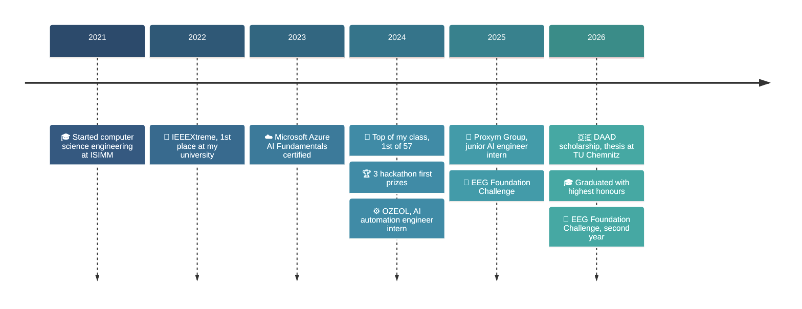
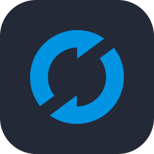
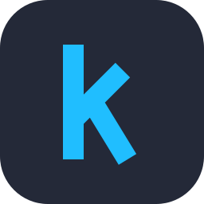
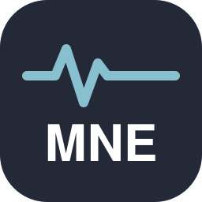

# Dhia Ben Hamouda

### AI Engineer · Machine Learning · LLM Systems · Automation

I'm a computer science engineer from Sousse, Tunisia. I build AI systems that people use at work:
document automation, LLM evaluation and decision support, from the model to the API and the interface.

I trained as a software engineer and planned to stay one. Then six months in a research lab at
TU Chemnitz showed me that I enjoy an open question as much as a working build, so now I do both.

## 📍 My path so far

| 🏆 Competitions | 👑 Academics | ⚙️ Automation | 🧪 Experiments |
|:---:|:---:|:---:|:---:|
| 15+ hackathons, 3 first prizes, and 1st at my university in IEEEXtreme | 1st of 57, graduated with highest honours | About 50% less document-processing time at OZEOL | 1,000+ ML training runs tracked and written up |

## 👋 Who are you looking for?

Click a box to open it. Everything stays on this page.

<table><tr><td>

<h3>🔬 A Research Associate / PhD candidate &nbsp;·&nbsp; click to open</h3>

> 📄 My [motivation letter](./BenHamouda_Dhia-Motivation_letter.pdf) covers my research interests and my reasons for pursuing a PhD.
> Write to me by [email](mailto:dhiabenhamouda.pro@gmail.com) or on [LinkedIn](https://linkedin.com/in/dhiabenhamouda) and I'll send the rest of my documents, including my transcripts.

### Research interests

- 🧠 **EEG neural decoding.** Models that hold up across participants and recording sessions, and that can show which features they rely on.
- 🤖 **Efficient agentic systems.** Making small language models reliable through system design, tool use and evaluation instead of scale.
- 🔋 **Machine learning for batteries.** Data-driven and physics-informed state estimation from impedance spectroscopy.

### Research experience

**Engineering thesis** · Technische Universität Chemnitz, Measurement and Sensor Technology · 02/2026 – 07/2026 · DAAD KOSPIE scholarship

*Comparative Analysis of Electrochemical Impedance Spectroscopy Representations for Machine-Learning-Based State-of-Charge Estimation of Lithium-Ion Batteries*

- Compared five representations of impedance spectra, alone and combined, with conventional ML and CNN architectures.
- Evaluated every model leave-one-cell-out, so each was tested on a battery cell it had never seen.
- Used SHAP and Grad-CAM to find the spectral regions the models rely on, and matched them to electrochemical processes.

### Independent project: EEG Foundation Challenge (2025 and 2026)

I have entered this international competition two years in a row, on my own, with a laptop that has a
4 GB GPU and Kaggle's free T4s.

**2025 · Reaction-time decoding.** The task was to predict how fast someone responds from two seconds of
129-channel EEG. I built the pipeline with MNE-Python and an attention-based regressor in PyTorch. The
result was an nRMSE of 1.00, no better than always predicting the average, and I had let the test set
steer the learning-rate schedule. I took two rules into the next year: fix the evaluation before
touching the model, and write down the results that fail.

**2026 · BCI decoding (Track 02), in progress.** The task is to tell which of three mental tasks a person
is doing (imagining a movement, subtracting numbers, generating words) from four seconds of 41-channel
EEG. The model is scored on people it has never seen and on later sessions of people it has.

The competition is still running, so I'm keeping the details for later. So far I have designed and
compared these families of models:

- compact convolutional networks that learn temporal and spatial filters
- recurrent and transformer models on top of convolutional features
- spectral models built on frequency-band power
- two-branch models that combine a learned view of the signal with a spectral one
- pretrained EEG foundation models with different heads and fine-tuning strategies
- self-supervised pretraining with several objectives
- ensembles of the above

I'll publish the full results and what I learned from them after the final deadline.

</td></tr></table>

<table><tr><td>

<h3>💼 An AI / Software Engineer &nbsp;·&nbsp; click to open</h3>

### Experience

**Research Intern, Machine Learning** · Technische Universität Chemnitz · Chemnitz, Germany · 02/2026 – 07/2026
- Built a framework that compares five data representations for estimating battery state of charge, with every model tested on cells it had never seen.
- Explained the models' predictions with SHAP and Grad-CAM.

**Junior AI Engineer (Internship)** · Proxym Group · Sousse, Tunisia · 06/2025 – 08/2025
- Built an LLM-as-a-Judge prototype that evaluates SQL with a Performer–Judge workflow. It evaluated 162 internal queries, with a reported 12% reduction in query runtime.
- Prototyped a credit decision-support tool that combines rules, ML and LLM reasoning, served through FastAPI with a React interface. A human reviews every recommendation.

**AI Automation Engineer (Internship)** · OZEOL · Sousse, Tunisia · 06/2024 – 09/2024
- Cut average document-processing time by about 50% by combining OCR, language detection and NLP classification for multilingual files.
- Delivered extraction and normalisation through a Flask API and a React interface, with reported extraction precision above 85% across PDF, Word, Excel and image inputs.

### Projects

- [**BtalaLos**](https://github.com/Dhia-dbh/BtalaLos): a self-hosted job-search workspace with AI-tailored CVs and cover letters, PDF export and application tracking (TypeScript)
- [**doc-flash**](https://github.com/Dhia-dbh/doc-flash): a FastAPI endpoint that returns your code with LLM-written docstrings and comments
- [**EducationAi**](https://github.com/Dhia-dbh/EducationAi): built from scratch in under 12 hours; won 1st prize at the Code of Duty hackathon
- [**AI-Powered-PDF-to-Excel**](https://github.com/Dhia-dbh/AI-Powered-PDF-to-Excel-Transformation): turns PDF tables and fields into spreadsheets
- **AWS three-tier deployment**: Angular and Node.js on AWS with Auto Scaling and RDS; server setup automated with Bash, PM2 and systemd behind Nginx

### How I run an ML project

These come from my EEG Foundation Challenge work, described in the research box above.

- **Evaluation first.** Cross-validation by participant, with checkpoints frozen before any test score is read.
- **Everything tracked.** More than 1,000 training runs logged in MLflow across 50+ experiment campaigns, each with a written verdict.
- **Built to a budget.** Trained on 4 GB of GPU memory, with inference kept inside the competition's time limit.
- **Tested before it ships.** I replay the organisers' Docker scoring pipeline locally before every upload.
- **Automated.** Scripts split the work across two Kaggle GPUs, resume after interruptions and package the results.

### Certifications

- **DeepLearning.AI**: Deep Learning Specialization · Natural Language Processing Specialization
- **NVIDIA**: Fundamentals of Deep Learning · Building Transformer-Based NLP Applications · AI for Predictive Maintenance
- **AWS Academy**: Cloud Foundations · Cloud Security Foundations
- **Microsoft**: Azure AI Fundamentals (AI-900)
- **Meta**: Front-End Developer Professional Certificate

</td></tr></table>

## 🧰 Stack

**🧪 Models and experiments**

**🤖 LLM apps and APIs**

**⚙️ Automation and deployment**

## 🎓 Education

**Engineering Degree in Computer Science** (Diplôme National d'Ingénieur) · ISIMM, University of Monastir, Tunisia · 09/2021 – 10/2026
Highest honours (Mention Excellent) · 1st of 57 in 2024 · Software Engineering specialisation

**Languages:** Arabic (native) · English (C1) · French (B2) · German (B1)

---

**Contact:** [dhiabenhamouda.pro@gmail.com](mailto:dhiabenhamouda.pro@gmail.com) · [linkedin.com/in/dhiabenhamouda](https://linkedin.com/in/dhiabenhamouda) · Sousse, Tunisia

